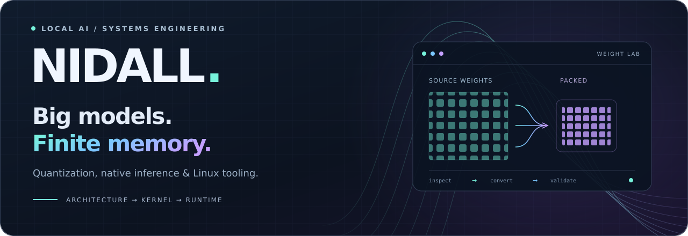

<picture>
  <source media="(max-width: 600px)" srcset="assets/header-compact.svg" />
  
</picture>

  <strong>Computer engineer building local AI tools, native model runtimes, and Linux software.</strong> 
  I work where model architecture meets quantization, kernels, and memory limits.

  <a href="#selected-projects">Selected projects</a> &nbsp;·&nbsp;
  <a href="#more-to-explore">More to explore</a> &nbsp;·&nbsp;
  <a href="https://github.com/NidAll?tab=repositories">All repositories</a>

## Selected projects

<table>
<tr>
<td valign="top">

01 / MODEL COMPRESSION
<h3><a href="https://github.com/NidAll/comfyui-native-quantizer">ComfyUI Native Quantizer ↗</a></h3>

Convert diffusion checkpoints and text encoders into native ComfyUI formats. Architecture-aware tensor selection, bounded conversion memory, optional MSE optimization, and output validation.

<code>Python</code> <code>INT8 / INT4 / FP8</code>

<a href="https://github.com/NidAll/comfyui-native-quantizer#quick-start">Quick start</a> · <a href="https://github.com/NidAll/comfyui-native-quantizer/releases">Releases</a>

</td>
</tr>
<tr>
<td valign="top">

02 / LINUX SYSTEMS
<h3><a href="https://github.com/NidAll/forgeusb">ForgeUSB ↗</a></h3>

A native Linux boot-media writer with a desktop app and CLI. Reviewed write plans, explicit device confirmation, a separate privilege helper, and full source-byte read-back.

<code>Rust</code> <code>Iced</code> <code>Polkit</code>

<a href="https://github.com/NidAll/forgeusb#screenshots">Screenshots</a> · <a href="https://github.com/NidAll/forgeusb/blob/main/docs/compatibility.md">Compatibility &amp; release limits</a>

</td>
</tr>
<tr>
<td valign="top">

03 / IMAGE UNDERSTANDING
<h3><a href="https://github.com/NidAll/ComfyUI-Anima-Prompt-Architect">Anima Prompt Architect ↗</a></h3>

Turn a reference image into Anima prompts locally. PixAI tagging and native MiniCPM INT8 inference produce positive and negative prompts, structured analysis, and tag probabilities.

<code>ComfyUI</code> <code>Vision + language</code>

<a href="https://github.com/NidAll/ComfyUI-Anima-Prompt-Architect#install">Setup &amp; example workflow</a> · <a href="https://github.com/NidAll/ComfyUI-Anima-Prompt-Architect/releases">Releases</a>

</td>
</tr>
<tr>
<td valign="top">

04 / SPEECH INFERENCE
<h3><a href="https://github.com/NidAll/ComfyUI-Qwen3-TTS-Quant">Qwen3-TTS Quant ↗</a></h3>

Voice design, voice cloning, and named-speaker generation for the Qwen3-TTS 1.7B family. Packed W8A8 ConvRot inference, static KV caches, and CUDA graph support with runtime diagnostics.

<code>Python</code> <code>Comfy Kitchen</code> <code>CUDA</code>

<a href="https://github.com/NidAll/ComfyUI-Qwen3-TTS-Quant#importable-workflows">Example workflows</a> · <a href="https://github.com/NidAll/ComfyUI-Qwen3-TTS-Quant#attention-and-cuda-graphs">Runtime details</a>

</td>
</tr>
</table>

## More to explore

- [**Stripe homepage reconstruction**](https://github.com/NidAll/stripe-homepage-reconstruction) · An unofficial visual study using Astro, GSAP, and a Three.js shader hero. Includes responsive screenshot comparisons and documented limits.
- [**Ming Image Prompt Builder**](https://github.com/NidAll/comfyui-ming-image-prompt-builder) · Draw regions, place exact text, and export structured Ming prompts inside ComfyUI.
- [**Qwen-Image 2.1 Turbo LoRA Tools**](https://github.com/NidAll/qwen-image21-lora-layout-converter) · Experimental local adaptation of base-model LoRAs for Turbo using a reusable transfer profile.

<strong>Earlier quantization work &amp; an upstream contribution</strong>

- [ComfyUI Mixed Quantizer](https://github.com/NidAll/comfyui-mixed-quantizer) is my earlier single-file converter, with stable W4A8 conversion and experimental mixed-precision planning.
- [OpenCode 2 support for Ask](https://github.com/benja/ask/pull/5) is an open pull request for compatibility with the terminal AI client.

## How I work

I like following an inference problem through the whole stack: tensor layout, kernel dispatch, attention, memory residency, and the runtime that ties them together. I care about reproducible conversions, useful diagnostics, and benchmarks that explain their limits.

**Tools I work with:** Python, Rust, C/C++, PyTorch, CUDA, ComfyUI, llama.cpp, and Linux.

Away from code: philosophy, mathematics, anime and manga, storytelling, penguins, and cats.

If a model technically shouldn't fit, that usually makes it more interesting.

